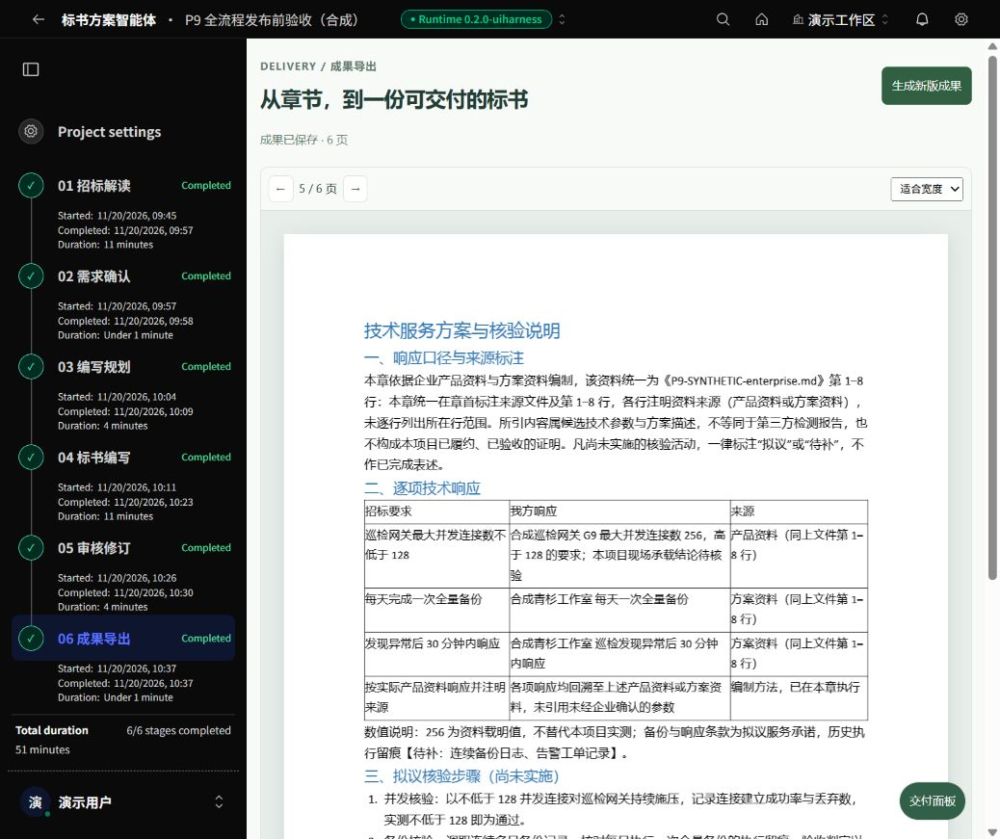

# Bid desktop baseline and Web migration inventory

核定日期：2026-11-25（Asia/Shanghai）。批次：B6.2。

本次从已经形成的完整桌面应用反推网页应用。迁移基线由 **RUYIN 宿主外壳、Bid 产品页面、运行能力** 三部分共同构成，不能把产品 iframe 内的六个页面当成完整应用。后续共用业务、能力定义和主要页面，分别适配运行环境。

## 1. 来源与证据

| 来源 | 核定内容 | 版本及边界 |
| --- | --- | --- |
| 原 Bid 桌面候选 | `portals/desktop/src/*`、构建器、基础产品契约 | 产品版本 1.17.2；原 checkout HEAD `13f46ee2b009973dde0e567e8b21526fcbbb86d5`，59 份源文件包含未提交内容，不能仅凭 HEAD 重建候选 |
| RUYIN 宿主 | 外壳、项目首页、左侧流程、项目设置、资料库宿主、任务/审核、存储、读取、排版 | checkout HEAD `8fb4cfcabb2cacc1e3842de54491d7bb9286cca6`，选取 41 份关键源文件；宿主另有未提交改动，文件摘要为本次核定依据 |
| 已提取的共享产品 | `portals/packages/workbench`、桌面适配及打包 | PR #16 / main `910969d9e3194117581426c0a975d6dbce088f45`；仅完成业务内容区的共享提取，未完成完整网页应用 |
| 历史桌面整链验收 | P9 的六步流程、原侧栏、时间记录、Word/PDF 成果 | 2026-11-20，产品 1.16.3，本地开发运行时、合成资料；不是当前 1.17.2 正式安装验收 |

[源文件及证据摘要](assets/bid-desktop-baseline.sources.json) 固定了三个来源的 161 份源文件以及 8 份历史证据。原始源码快照保存在本任务本地验收目录 `bid-desktop-baseline-20261125/source-snapshot`；未改动两个原开发 checkout，也未收集环境文件、密钥或客户项目正文。

原桌面整链验收外观如下。后续 Web 应用应保持其中与 Bid 有关的完整结构；不得用新的横向步骤条替代左侧流程。

## 2. 完整页面及操作清单

下表的 RUYIN 路径均相对于 `vxture-ruyin`，Bid 路径均相对于本产品仓库。路径用于定位现有实现，不授权跨仓改动。

| ID | 页面或区域 | 已有实现位置 | 现有行为与迁移要求 |
| --- | --- | --- | --- |
| D01 | 标题栏与产品/项目身份 | RUYIN `apps/ui-workspace/src/workbench.tsx` | 产品和项目身份、返回、工作区及用户入口。Web 保留产品所需身份和范围信息；不重做一套产品品牌和导航 |
| D02 | 产品首页、项目目录 | RUYIN `product-home.tsx` | 创建、搜索、在用/归档筛选、排序、打开、继续上次项目；模板卡片部分仍是占位，不能记为完整模板中心 |
| D03 | 左侧业务流程 | RUYIN `project-workflow-nav.tsx`、`product-navigation.ts`、`app.css` | 收缩/展开、项目设置、六步流程、当前环节、状态、每步时间和耗时、完成数及全程耗时。属于完整页面基线 |
| D04 | 项目设置与项目文件 | RUYIN `workspace.tsx`、`workspace-tabs.ts` | 项目摘要、归档恢复、文件导入和已有控制面；Web 需要其中的项目功能，不迁入 RUYIN 全局设置 |
| D05 | 知识资料库 | Bid `library-ui.mjs`；RUYIN `project-library.tsx`、`product-library.ts` | 资质、人员、产品、方案、案例分类，搜索、导入、版本、原文与读取状态；选入项目时固定版本快照 |
| D06 | 招标解读 | Bid `reading-ui.mjs`、`batch-analysis-ui.mjs`、`source-verification-ui.mjs`、`clarification-ui.mjs` | 读取原件、原文页/块、表格和待核对项、分批解读、证据引用匹配、标包范围核验、候选处理、投标人侧澄清询问建议 |
| D07 | 需求确认 | Bid `requirements-ui.mjs`、`requirements.mjs` | 商务/技术分类、搜索、确认状态筛选、分页、依据查看、人工补充/复核、确认、自动保存；来源变化后重新核验 |
| D08 | 编写规划 | Bid `plan-ui.mjs`、`plan-result.mjs`、`plan.mjs` | 编写意图、篇幅、范围、质量、模板等约束；模型生成目录和需求覆盖；候选确认/放弃；需要时手工调整 |
| D09 | 标书编写 | Bid `writing-ui.mjs`、`writing.mjs`、`chapter-evidence.mjs` | 分章后台生成、进度、暂停继续、单章重写、候选采纳/放弃、历史保留、资料缺口及企业证据引用 |
| D10 | 审核修订 | Bid `review-ui.mjs`、`review.mjs`、`evidence-review.mjs` | 需求覆盖、指标、企业事实、来源有效性与跨章节冲突；查看原文、记录处理、生成修订候选；修改后旧报告标为历史 |
| D11 | 成果导出 | Bid `delivery-ui.mjs`、`delivery.mjs`；RUYIN `document-renders.ts`、`word-layout.ts` | 合稿、目录、模板、页眉字段、版本、PDF 预览、MD/DOCX/PDF 下载和交付检查。实际排版当前依赖 Windows Microsoft Word |
| D12 | 企业证据面板 | Bid `evidence-ui.mjs`、`evidence.mjs` | 事实提取、有效期/冲突/不确定性标记、需求匹配、人工决定、当前与历史证据、资料变化后的失效检测 |
| D13 | 任务和人工确认面板 | RUYIN `pending.tsx`、`workspace.tsx`、`product-surface.tsx`；Bid `business-review.mjs` | 任务资料授权、执行状态、人工检查点与结果审核。正式确认由宿主检查点决定，产品页面不能自行伪造审核通过 |
| D14 | 本地运行与恢复 | RUYIN `background-jobs.ts`、`task-runner.ts`、`storage.ts`、`file-store.ts`、读取/排版服务 | 加密保存、文档修订校验、后台执行、重试、取消和恢复；文件读取/排版中断保留结果并提示重试，不能宣称所有任务都无缝续跑 |

表中未加路径前缀的 Bid 文件位于 `portals/packages/workbench/src/`。原始对应文件仍保留在桌面候选的 `portals/desktop/src/`。

## 3. 侧栏及进展记录必须保持的行为

- 六个环节固定为招标解读、需求确认、编写规划、标书编写、审核修订、成果导出。
- 状态为未开始、进行中、已完成、待处理；当前浏览位置与业务完成状态分别表达，不能把点开页面当成完成。
- 每步展示开始时间、完成时间和耗时；没有真实记录时显示未记录，不根据查看时间补造历史。
- 已完成环节使用完成标记，保留纵向连接线、项目设置入口、收缩操作和当前环节选中状态。
- 汇总展示已完成环节数；全程耗时仅在全部完成且具备时间记录时给出，不用“现在”假造结束时间。
- `WorkflowRecords` 保存 `bid_workflow` 并发布 `state`、`startedAt`、`completedAt`；原宿主消费这些数据。Web 必须完整呈现这些字段，不能只消费 label。
- 原 `ProjectWorkflowNav` 的两项组件测试覆盖设置入口、阶段状态、时间及收缩展示；迁移后需要等效验证，不能只测试六个按钮可点击。

## 4. 一条完整操作链

产品首页/项目目录 → 创建或打开项目 → 项目设置导入招标原件、参考资料及可选模板 → 选择资料库版本 → 原文读取 → 分批解读和来源/标包核验 → 需求确认 → 规划与人工确认 → 分章编写与候选确认 → 审核修订 → 排版、预览和下载 → 重开项目核对正文、资料快照、进展和成果版本。

后台任务、资料授权和人工确认属于这条链的一部分。只迁移六个内容页不能满足该操作链。

## 5. 数据、任务与运行环境

| 对象 | 桌面当前归属 | Web 适配要求 |
| --- | --- | --- |
| 项目与身份范围 | RUYIN 宿主项目元数据、平台组织/工作区 | 由已验证身份确定工作区；项目 ID 只是业务标识，不建立访问权限 |
| 需求、规划、正文、进展 | `bid_requirements`、`bid_plan`、`bid_draft`、`bid_workflow` 等产品文档 | 保持文档结构、章节标记、修订号和冲突行为，不改成另一个简化 proposal JSON 模型 |
| 企业事实与引用 | `bid_evidence_*`、章节证据和资料版本快照 | 保留版本、原文位置、哈希、人工决定和失效判断；新资料不能悄悄替换历史依据 |
| 任务定义与结果 | 产品契约任务、后台 job/step、结果文档、人工检查点 | 两端使用相同业务目标、约束、校验和候选采纳规则；执行调度由环境适配 |
| 本地资料 | 加密项目库、加密文件存储、SHA256 固定的读取快照 | 网页上传和服务端存储需要独立实现；不自动上传现有桌面项目 |
| 原文读取 | 固定 Python 子进程，PDF/DOCX/MD，逐页/块保存 | 核查服务端依赖和进程隔离后适配；目前没有扫描件 OCR |
| 排版 | 通用 DOCX 生成后经 Windows Word 排版，输出 PDF 和页码 | Linux 产品容器不能直接执行现有 Word COM；先核定可用路线及版式兼容，再实施 |
| 模型调用 | 宿主任务运行器支持既有远端能力通路和用户私有模型配置 | Bid 生产调用需要自己的有效产品身份；不能用 Workbench 会话句柄冒充产品 bearer，也不向 RUYIN 申请 Atlas/Runos 执行授权 |
| 下载 | 宿主签发受限、短期、单次下载票据 | 网页实现等效的身份和成果范围校验，不暴露任意文件路径 |

RUYIN `packages/runtime-core`、`packages/document`、`packages/cli` 是设计上的公开包边界；`apps/local-host` 和 `apps/ui-workspace` 不发布为 npm 包。Web 不能通过跨仓源码导入把整个桌面守护进程拉入产品。

B6.3 只读预检（2026-11-25）：GitHub Packages 的 `ruyin-core`、`ruyin-document`、`ruyin-contract-schema`、`ruyin-cli` 均为公开包，但各自可见的版本列表仅有 **0.1.0**；当前桌面源码 package.json 为 **0.2.0**。仓内版本不等于可安装版本。后续应先验证包的实际导出与所需 API 差异，确定现有发布流程能否提供所需版本，再确定复用接线；本批不发布包、不跨仓导入私有应用源码。

## 6. 完成度及证据分级

| 项目 | 已有证据 | 不能据此推定的内容 |
| --- | --- | --- |
| 六步本地业务链 | P9 / 1.16.3 记录六步链、单章修订、保存恢复、旧项目保护，生成 6 页 MD/DOCX/PDF；同批记录产品 91、宿主服务 136、工作台 UI 673 项测试 | 不代表 1.17.2 正式安装版或平台生产模型链路验收 |
| 企业证据与审核 | P8.2、P8.3、P8.4 有合成资料的提取、匹配、引用、单章修订、旧报告失效及重启保护记录 | 不代表任意客户资料均已验证、也不作自动合规认证 |
| 文档读取 | P7 有实际 PDF 89 页/块保存、DOCX/MD 读取和异常提示记录 | 不包含 OCR；读取完成不等于招标需求分析完整 |
| 最新桌面候选 | 1.17.2 原业务 99 项测试；可生成明确标为未签名的产品包 | 不代表可信生产安装、更新、正式签名已完成 |
| 共享提取 | PR #16 的 380 项测试、双端资源比对、契约比对及构建；内容区可复用 | 该次遗漏宿主外壳；横向导航预览被用户否定，不是可接受的完整 Web 页面 |
| 已上线产品 API | v0.1.4 有真实 Starter 订阅、产品 API、技能包和一次模型用量验收 | 不代表桌面产品身份和完整桌面任务已接入该生产 API |

总体状态为：**已有本地开发 MVP 和整链历史验收，尚未完成当前版本的正式商业桌面交付。**

## 7. 未完成与明确排除

- 桌面调用 Bid 生产服务的产品身份链路、后台任务原范围续权，仍需与现有平台能力核对。
- 正式签名权威、公钥/目录分发、安装升级和旧数据保留，需要当前产物验收。
- 网页的完整外壳及服务端项目/文件/任务/审核/排版尚未交付。
- 独立标书对比功能、方案数/存储/对比次数等套餐规则的完整执行闭环尚未证实完成；已有目录候选比较或证据对照不能冒充标书对比。
- 模板中心仍有占位；项目内自定义模板已有实现，两者分开验收。配图选项存在不代表自动配图产线完成。
- 本期不实现跨端云同步、不展示相关入口、设置或宣传文案。Web 持久化不等于桌面项目同步。
- 订阅、权益、订单、账单管理继续进入 Console。产品接入限配置，不改平台源码或 worker01；本产品所需服务配置限 worker02。

## 8. 后续批次

B6.3 先核定运行差异及关键缺口；B6.4 以 D01-D14 为清单复用完整产品界面。页面结构沿用本基线，不另起编辑器，不用横向导航替换原流程栏。后续 B6.5-B6.10 的目标与验收门槛见[双端批次计划](../70-workplan/160-dual-surface-release.md)。

B6.2 清理回归：275 项产品测试、103 项共享/适配测试、3 项桌面传输测试，共 381 项通过；类型/语法检查、文档编号、数据结构、占位符、端口校验，以及隔离目录中的 Next standalone 构建和启动检查通过。没有用这些检查替代当前桌面正式安装验收。
