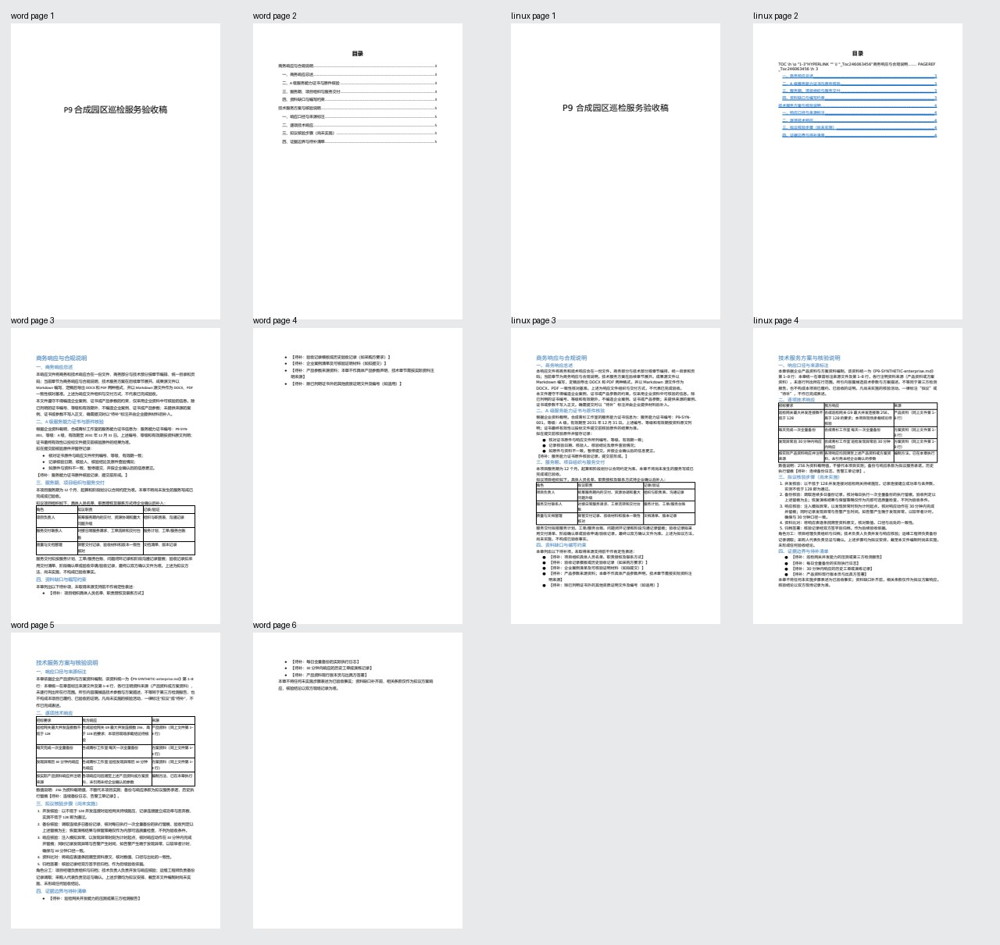

# Bid Web runtime adaptation preflight

核定日期：2026-11-25（Asia/Shanghai）。批次：B6.3。

结论：**完整桌面可以作为 Web 的业务和页面基线，但不能直接部署桌面守护进程。** 本批完成了运行差异验证，尚未实现 Web 项目、任务或排版服务。继续保持[完整桌面基线](50-desktop-baseline.md)的 D01-D14 页面和控制面，不另做编辑器或导航。

本页是 Bid 的迁移调查及批次记录，不新增平台接口规范。平台接入仍遵循既有通则；本批没有修改平台源码、worker01 配置、生产服务、数据库、凭据或产品权限。

## 1. 核定来源

| 对象 | 核定依据 |
| --- | --- |
| Bid 共享应用 | main `49a478bbc20c37424198ae9603580febd3d16e7a`；包含 PR #16 的共享提取和 PR #17 的完整基线/清理 |
| 桌面和宿主 | `50-desktop-baseline.md` 固定的 161 份源文件摘要；原开发 checkout 保持原状 |
| RUYIN 公开包 | GitHub Packages 的实际 0.1.0 tarball；下载后核对声明的 SHA-512 完整性，再隔离检查和执行 |
| RUYIN 当前远端主干 | `3d3df8169b25957c56f322a5e8438ada42b1d40e`；四个公开包的 manifest 为 0.2.0，但没有 `projectDocuments` 和原桌面 `project-workflow-nav.tsx`。本机交付分支与远端主干不是同一功能基线 |
| 产品服务器 | worker02 的只读环境检查；隔离容器只使用 P9 合成资料，不连接生产卷、数据库、环境文件或公共端口 |

[机器摘要](assets/bid-runtime-preflight.json)保存包兼容结果、输入/输出摘要、读取结果、测试数量和未完成门槛。详细执行日志保存在本任务 `bid-runtime-preflight-20261125` 验收目录；不包含生产凭据或客户正文。

## 2. 公开依赖：源码 0.2.0 不等于已发布

| 包 | 实际可见版本 | 源码版本 | 核定结果 |
| --- | --- | --- | --- |
| `@vxture/ruyin-contract-schema` | 0.1.0 | 0.2.0 | 发布包仅支持契约 0.1，拒绝当前 Bid 的 0.2 契约 |
| `@vxture/ruyin-core` | 0.1.0 | 0.2.0 | 发布包 `RuntimePorts` 没有当前任务需要的 `projectDocuments` |
| `@vxture/ruyin-document` | 0.1.0 | 0.2.0 | 有 Markdown/HTML/DOCX 能力；不含 Word COM 或完整模板分页服务 |
| `@vxture/ruyin-cli` | 0.1.0 | 0.2.0 | 需随兼容契约的一组包验收，不能用旧包替代当前打包器 |

实际执行 0.1.0 校验器时，当前 Bid 契约被拒绝的原因包括 `product.ui`、产品码 `bidproposal`、`project_document` 上下文、任务名称和技能声明；相同输入经本机交付分支的 0.2.0 源码校验通过。不能为了安装旧包而降低 Bid 契约或丢弃项目文档上下文。

另外核对远端 main 的实际内容：尽管 manifest 同为 0.2.0，`RuntimePorts` 没有 `projectDocuments`，契约 schema 没有 `project_document`，原流程侧栏文件也不存在。**不能直接给远端 main 打 0.2.0 发布 tag 来解决问题。** 先从固定的原交付基线核对并整理必要改动，经过正式送审、检查及合并，再发布验证过的功能版本；版本号本身不是兼容证据。

RUYIN 现有 `publish-packages.yml` 使用独立的 `packages-v*` tag，四包同版本，依次发布 schema、document、core、CLI；最近一次成功记录仍是 `packages-v0.1.0`。[发布流程记录](https://github.com/vxture/vxture-ruyin/actions/runs/33751659190)。后续应从经过检查且包含必要功能的干净源码走这条既有流程，再让 Bid 锁定确实可安装的版本。本批没有发布包，也没有将跨仓源码路径写进依赖。

## 3. 身份：Web 已有产品身份，桌面链路仍需补齐

Web 已有 Bid 自己的 Accounts RP：PKCE、state、nonce、精确回调、同源相对返回路径；浏览器持有不透明 cookie，访问及刷新令牌保存在服务器 Redis。产品操作从经过验证的令牌读取用户、组织和工作区，再做 C2 权益及成员准入检查。

定向运行 `capability/caller.test.ts`、`capability/access.test.ts` 和 `auth/lib/claims.test.ts`，**26 项通过，0 失败**。覆盖本产品 RS256 身份、错误/多个 audience、过期/伪造令牌、cookie 和请求来源、身份/权益读取失败时拒绝执行。没有实际模型调用。

桌面宿主当前能力网关读取的是 Workbench 登录凭据；它不能冒充 Bid 的产品令牌。Bid 尚未实现可验收的桌面一次性交接链路。后续只能基于已存在的平台能力适配本产品身份；不放宽 audience、不复用 Console/Workbench 会话句柄，也不给 RUYIN 增加 Atlas/Runos 执行授权。若现有平台能力不足，应先提出具体缺口，而非修改平台或增加隐式信任。

## 4. 存储、任务和审核边界

| 能力 | 原桌面实际行为 | Web 适配边界 |
| --- | --- | --- |
| 项目 ID | 内核调用 `newId("prj")`，不能假定现有项目都是裸 UUID | 先确定并兼容内核标识，再落地服务端路由；保留的 Web transport 中 UUID 限制只是未接线草案 |
| 项目文档 | 产品 Markdown、修订号及比较后写入；`bid_requirements` / `bid_plan` / `bid_draft` / `bid_workflow` 等已有格式 | 保留格式、修订冲突和失效校验；不能另造简化 proposal JSON。每次操作由已验证身份检查项目所属工作区和产品 |
| 资料库与快照 | 按工作区/产品隔离，固定文件哈希、资料版本、页/块和项目选入快照 | 服务端保存相同语义；不自动上传桌面库，不让最新资料替换既有依据 |
| 本地加密 | SQLCipher 项目库、项目密钥及加密文件，依赖本地存储实现 | 不能把桌面数据库目录作为多租户服务端存储直接挂载；服务端存储、事务和配额在 B6.5 单独验收 |
| 后台任务 | 持久化 job/step、契约和请求哈希、资料修订、任务实例和请求幂等键 | 保留任务上下文、输入固定、暂停/取消/重试及候选采纳；服务端调度适配，不在 UI 模拟完成 |
| 人工确认 | 内核检查点确认；仅已记录并匹配当前请求/契约/上下文的批量资料授权可继续 | 保留真实检查点。产品页的候选采纳不能取代宿主授权和结果审核 |
| 重启恢复 | 后台 job 可检查已有任务恢复；不确定任务不自动重复提交。读取/排版中断标为失败并保留已有成果 | 分别展示恢复、待确认和需重试，不能宣传全部任务无缝续跑 |
| 下载 | 有限范围、短期、单次票据，成果文件必须属于当前项目 | 同时验证用户、工作区、项目、成果版本和票据；不向浏览器暴露服务器路径 |

本节存储及恢复结论来自固定源码的检查，不冒充新的服务端实现或并发/故障验收。现有产品任务和结果校验继续来自共享 workbench；运行时的身份、存储、文件、队列和检查点适配尚未交付。

## 5. 原文读取：Linux 可行，生产尚未接线

生产 Bid 容器是 Node 22.23.5 / Linux Alpine，没有 Python、LibreOffice 或 Word。原读取适配器是固定 Python 子进程，限制输入、输出、时间和事件顺序，不接受产品提供的可执行命令。

本批在 worker02 建立独立 Python 3.12 Debian slim 测试镜像，使用**相同 reader.py 和 requirements.lock**，以 `--require-hashes --only-binary=:all: --no-deps` 安装固定依赖。实际执行时禁网、只读根目录、非 root、移除 capabilities、限制内存/CPU/PID，只读挂载合成输入。

| 输入 | 结果 | 实际核验 |
| --- | --- | --- |
| P9 Markdown | 1 个块 | 文本逐字保留、块序号、总数及结束输入 SHA-256 |
| P9 DOCX | 47 个块、2 张表 | 段落/表格、块序号、总数及输入摘要；明确报告分页不可用、自动编号未渲染、域未求值 |
| P9 Word PDF | 6 个页块、2 张表 | 原页码 1-6、块序号、总数及输入摘要 |

这证明现有读取协议和锁定依赖在 Linux glibc 环境可运行；没有证明 Alpine 原生依赖已适配、扫描件 OCR 已实现，或所有客户文件均可读取。建议沿用固定、隔离、可取消的读取 worker；本批不改变生产镜像。

## 6. 排版：普通转换成功，正式候选未通过

桌面 `word-layout.ts` 明确要求 Windows Microsoft Word，使用 PowerShell 和 COM 完成模板、目录、页眉、页码及输出。`ruyin-document` 的 DOCX 生成不能替代该过程。

使用**已经由 Word 排版的** P9 合成 DOCX，在独立 Debian / LibreOffice 7.4 / Noto CJK 镜像中实际转换。执行容器禁网、只读、非 root，限时和限资源。结果如下：

| 项目 | 桌面 Word 基准 | Linux 转换 |
| --- | --- | --- |
| 页数 | 6 | 4 |
| 字体 | Microsoft YaHei / Calibri 等 | Noto CJK / DejaVu 替代 |
| 目录 | 正常文字及页码 | 首条出现可见 `TOC` / `HYPERLINK` / `PAGEREF` 域代码，链接外观及分页变化 |
| 判定 | 历史桌面合成验收基准 | 转换能力可行；不满足正式交付保真，不能直接接入 |

对两份 PDF 的全部页面做了渲染检查和文字核对。该实验甚至尚未覆盖 Markdown 到模板再到 DOCX/PDF 的完整流程，不能据转换返回成功就显示“导出完成”。也不能为缩小差异而把 Windows 商业字体直接复制到服务器。

B6.7 先比较可维护的服务器排版方案：在 Bid 自己的隔离 worker 中修正并验证 LibreOffice 模板/字体/域处理，或采用具备合适授权的办公排版服务。保持 Markdown 和失败记录；只有实测满足目录、页眉、模板、长表、分页及输出一致性的路线才进入产品。尚未选择、接入或部署正式引擎。

## 7. B6.4 的实施顺序

1. **先整理原交付依赖，再补可复用入口。** RUYIN 远端主干尚不包含固定基线的完整侧栏/任务文档能力，不能丢弃本机分支已有实现。先以文件摘要核对必要改动，保留其他未提交内容。RUYIN 的公开边界是 `packages/`；`apps/ui-workspace` 和 `apps/local-host` 只随安装包交付，不存在可供 Bid 安装的完整 UI 包。再核定从原宿主提取最小、无环境依赖的公共呈现组件的范围及正式发布方式，让原桌面和 Bid Web 消费同一源。不要把跨仓 `apps/` 路径写进产品，不复制整套守护进程，也不在 Bid 重写一个相似侧栏。原依赖送审、公共包发布与组件提取均不属于本批已完成内容。
2. **先侧栏和项目框架，再运行接线。** 按原桌面保留项目身份、项目目录、设置/资料库入口、六步纵向流程、状态、开始/完成时间、耗时、总进度和收缩；显示与环境无关，操作由注入的适配器承接。没有真实时间就显示未记录，浏览页面不改变完成状态。
3. **挂载原共享业务页。** 使用已经提取的需求、规划、正文、证据、审核和导出组件；运行能力尚未可用时明确保留未完成门槛，不伪造任务或持久化。
4. **按 D01-D14 比对完整页面。** 核对左侧流程、窄屏、滚动、项目/资料/任务面板和人工确认，先做合成输入下的 UI 回归；B6.5-B6.7 再接受真实身份、数据、模型和成果链路。

本批没有新增公开 UI 包，也没有修改 RUYIN 的应用/规范。下一步需要先把组件复用、0.2.0 公开依赖、桌面身份及排版路线这些具体门槛分别收敛，不能以未发布源码或另一套临时页面掩盖它们。Web 项目持久化与桌面本地项目保持各自环境边界，本期无跨端云同步。
